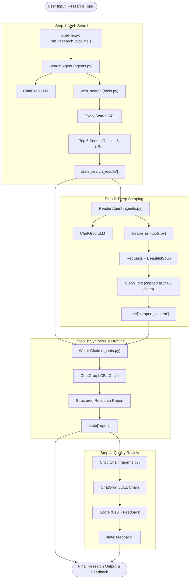
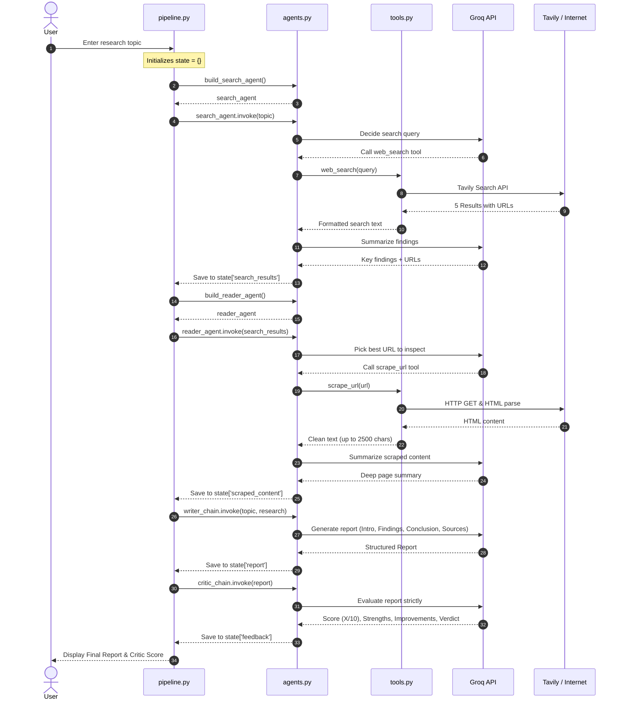

# Multi-Agent AI Research System

An autonomous, multi-agent AI research pipeline that takes any research topic, queries real-time web sources, scrapes full-text web pages, drafts a structured academic/industry research report, and evaluates its own output through a critic agent.

Powered by **Groq** (`openai/gpt-oss-20b`), **Tavily API**, and **LangChain**.

---

## Architecture Diagram



---

## Sequence & Execution Flow



---

## File Structure & Responsibilities

| File | Role | Key Functions / Components |
|---|---|---|
| **`tools.py`** | External tool execution | `web_search()` (Tavily), `scrape_url()` (BeautifulSoup) |
| **`agents.py`** | AI agent definitions & chains | `build_search_agent()`, `build_reader_agent()`, `writer_chain`, `critic_chain` |
| **`pipeline.py`** | Workflow supervisor | `run_research_pipeline(topic)` |

---

## Setup & Running

### 1. Prerequisites
- Python 3.10+
- Groq API Key ([groq.com](https://console.groq.com))
- Tavily API Key ([tavily.com](https://tavily.com))

### 2. Install Dependencies
```bash
python -m venv .venv
source .venv/bin/activate  # On Windows: .venv\Scripts\activate
pip install -r requirements.txt
```

### 3. Environment Variables
Create a `.env` file in the project root:
```env
GROQ_API_KEY=your_groq_api_key_here
TAVILY_API_KEY=your_tavily_api_key_here
```

### 4. Run the Pipeline
```bash
python pipeline.py
```
Enter your topic when prompted (e.g. `What is the impact of war on stock markets?`). The complete autonomous research process takes ~10-15 seconds.
